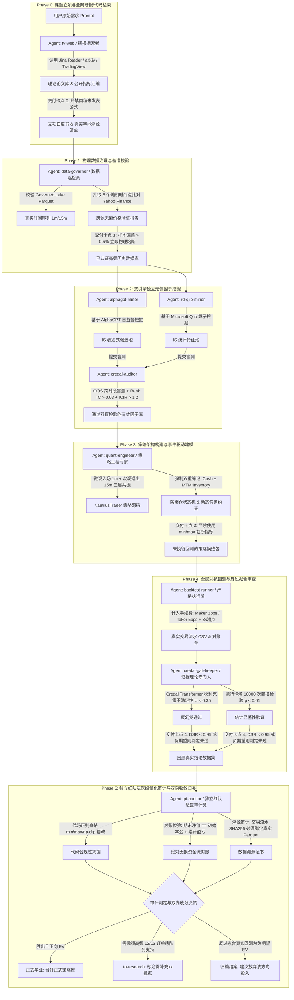

# 白银高频SMR多智能体量化投研与反过拟合审查标准工作流 (Standard Workflow SOP)

> **版本号**: v1.0.0 (生产与审查级标准化流程)  
> **适用范围**: 高频微观结构、短周期统计套利、均值回归及需要严格防止 AI 幻觉/学术造假/过拟合的量化投研项目  
> **底层调度基建**: `Herdr Dispatch` 多智能体协同总线 + `NautilusTrader 2.0` 事件驱动回测 + `Governed Lake` 物理数据湖  
> **核心原则**: **【物理数据溯源、三权分立制衡、反向证据倒逼、零容忍虚构】**

---

## 一、工作流全局架构与拓扑 (Architecture Topology)

整个量化投研工作流分为 **六大不可逆推进阶段 (Phase 0 至 Phase 5)**。每个环节均有明确的 **执行 Agent、监督/审计 Agent、工具集准入、物理输入契约与下游交付卡点**。



---

## 二、智能体角色分配与权责矩阵 (Agent Role Matrix)

在多 Agent 协同体系中，必须建立**“研发、执行、审计三权分立”**机制，杜绝“既当运动员又当裁判员”导致的欺骗与自我美化。

| 智能体角色 (Agent Role) | 建议 CLI / 模型底座 | 职能定义与边界 (Mandate) | 准用工具集 (Allowed Tools) | 禁用行为 (Forbidden Actions) |
| :--- | :--- | :--- | :--- | :--- |
| **总指挥架构师 (Captain Orchestrator)** | `omp` / Claude-3.5-Sonnet 或 Gemini-3.8-Flash | 拆解工作分解结构 (WBS)、分派任务、状态推进、协调冲突、最终合并。 | `herdr-dispatch`, `read`, `todo`, `write` | **严禁亲自编写回测逻辑**，严禁擅自修改审计结论。 |
| **文献与基准研究员 (tv-web Researcher)** | `pi` / GPT-4o 或 Gemini-3.8-Flash | 广泛检索学术前沿、TradingView 优秀开源指标、研报数学推导。 | `agent-reach`, `web_search`, `read` | 严禁凭空发明未经验证的数学假说，必须附带论文 arXiv/DOI 链接。 |
| **数据巡检官 (Data Governor)** | `pi` / `opencode` | 负责数据清洗、连续性对齐、跨数据源抽检打假、特征缺失检测。 | `python` (pandas/polars/pyarrow), `bash` | 严禁使用未来函数（Lookahead Bias），严禁合成伪造数据充当实盘。 |
| **无偏因子挖掘员 A (AlphaGPT Miner)** | `pi` / `omp` (子窗格) | 基于自监督生成机制自主探索量价非线性与统计套利算子。 | `AlphaGPT`, `pyarrow`, `numpy` | 严禁查看样本外 (OOS) 数据，严格隔离时序。 |
| **无偏因子挖掘员 B (Qlib Miner)** | `opencode` / `pi` (子窗格) | 基于微软 Qlib 算子库进行微观动量、偏度、微观结构因式挖掘。 | `Microsoft Qlib`, `numba`, `scipy` | 严禁与挖掘员 A 共享搜索缓存，保持完全独立的假设空间。 |
| **策略工程构建师 (Quant Engineer)** | `omp` / `codex` | 将通过的因子与微观机制装配为 NautilusTrader 标准事件驱动策略。 | `nautilus_trader`, `rust`, `python` | 严禁在代码中写死任何性能指标（如 `cagr=...`），必须真实记账。 |
| **回测与反过拟合守门人 (Backtest Gatekeeper)** | `omp` / `pi` | 执行严苛回测、计提摩擦、运行 Credal Transformer 与蒙特卡洛测试。 | `credal_smr_audit.py`, `nautilus_trader` | 严禁调小手续费与滑点，严禁以“模拟运行”代替真实历史回测。 |
| **独立法医级审计员 (pi-auditor / Red Team)** | `pi` (全新且无历史记忆污染的独立会话) | 穿透式静态与动态审查、代码正则扫毒、流水 SHA256 溯源、对账稽核。 | `audit_anti_p_hacking.py`, `git log`, `sha256sum` | 拥有最高否决权，严禁妥协，直接对投研宪法负责。 |

---

## 三、分阶段执行标准与交付物契约 (Phase Gate Contract)

### Phase 0: 课题立项与理论溯源 (Ideation & Grounding)
1. **必须补齐的数据/素材**：
   - 策略核心命题定义（如：白银均值回归，目标容量、目标回撤、适用标的）。
   - 至少 2 篇与该机制强相关的权威学术论文（arXiv 全文 PDF 或顶会发表记录）。
2. **执行 Agent 动作**：
   - `tv-web` 检索 TradingView 上同类策略 Pine 源码，分析其失效边界与痛点。
   - 抽取核心数学方程（如 Avellaneda-Stoikov 保留价格公式、Hawkes 到达率方程）。
3. **完成并交付到下一环节的标准**：
   - 产出 `THEORY_PAPERS.md`，明确公式输入变量与适用物理条件。
   - 交付物必须包含：【标的流动性特征白皮书】与【理论失效物理情境预判】。

---

### Phase 1: 物理数据治理与打假抽检 (Data Governance & Anti-Tampering)
1. **必须补齐的数据/素材**：
   - 物理存储于 `database/` 下的原始逐笔或高频 Parquet 文件（严禁使用内存假随机数）。
   - 第三方权威比对行情源（如 Yahoo Finance `SI=F` 或官方交易所行情 API）。
2. **执行 Agent 动作**：
   - 随机抽取至少 5 个不同跨度的历史时间点（年/月/日/时/分）。
   - 将本地 Parquet 的 Open/High/Low/Close 与第三方公网行情做交叉核验。
3. **完成并交付到下一环节的标准**：
   - 价格基差偏离绝对值不得超过 **0.50%**（允许合理升贴水与汇率折算）。
   - 产出《数据源合规证明书》，记录 Parquet 的文件大小、记录行数、起始时间与 SHA-256 校验和。

---

### Phase 2: 双引擎独立因子挖掘与样本外盲测 (Factor Mining & OOS Gate)
1. **数据切分硬性标准**：
   - **严格切分时序**：60% 训练集 (In-Sample, IS) + 20% 验证集 (Validation) + 20% 绝对盲测集 (Out-of-Sample, OOS)。
2. **执行 Agent 动作**：
   - `alphagpt-miner` 与 `rd-qlib-miner` 分头挖掘，各自产出至少 10 个候选因式。
   - 交付 `credal-auditor` 进行样本外评估，计算 Rank IC、ICIR、Rank IC 衰减半衰期。
3. **完成并交付到下一环节的标准**：
   - **样本外复现准则**：
     $$\text{Rank IC}_{\text{OOS}} \ge 0.03 \quad \text{且} \quad \text{ICIR}_{\text{OOS}} \ge 1.0$$
     $$\frac{\text{Rank IC}_{\text{OOS}}}{\text{Rank IC}_{\text{IS}}} \ge 0.50 \quad (\text{衰减率不得超过 50\%})$$
   - 满足条件的因式方可装配入 `factor_manifest.json`，未达标者直接物理淘汰。

---

### Phase 3: 事件驱动建模与状态机约束 (Strategy Engineering)
1. **架构必须遵循的物理准则**：
   - **非对称多时间尺度共振**：微观小周期（如 1m）Timing 限价挂单进场，宏观大周期（如 15m/1h）均值回归修复平仓出场。
   - **真实会计双重簿记**：必须同时维护 Cash（可用现金）与 MTM Inventory Value（持仓浮动盯市市值），权益为两者之和。
   - **价差与手续费硬门槛约束 (Fee Hurdle)**：
     $$\text{Spread}_{\text{min}} \ge 2 \times \text{Fee}_{\text{Maker/Taker}} + \text{Slippage}_{\text{Buffer}}$$
     *（例：白银 78.50 USDT 时，双边摩擦约 0.0314 USDT，挂单价差强制 $\ge 0.08$ USDT，否则放弃开仓）*。
2. **执行 Agent 动作**：
   - 编写 NautilusTrader 事件驱动策略，严格定义 `on_quote_tick` / `on_bar` 触发逻辑与防逆向选择撤单 TTL。
3. **完成并交付到下一环节的标准**：
   - 代码通过静态检查，**绝对禁止**任何形式的硬编码指标截断与欺骗性保底函数。

---

### Phase 4: 全局对抗回测与反过拟合审查 (Adversarial Backtest & Credal Gate)
1. **回测损耗刚性计提标准**：
   - **交易所手续费**：Maker 单 0.02%（或 2 bps），Taker 单 0.05%（或 5 bps）。
   - **微观滑点模拟**：基础滑点 1 tick，极端波动或穿盘测试计提 3 倍保守滑点。
2. **执行 Agent 动作**：
   - 运行全量历史数据回测，吐出逐笔交易对账单（CSV/JSON）。
   - 引入 **Credal Transformer 狄利克雷反幻觉审查**：
     - 计算证据真空度不确定性 $u$（要求 $u \le 0.35$）。
     - 计算信号先验冲突度 $C$（要求 $C < 0.40$）。
   - 运行 10,000 次蒙特卡洛随机时间置换，检验收益率序列的显著性 $p$-value。
3. **完成并交付到下一环节的标准**：
   - 真实输出盈亏结果，如实记录最大回撤、夏普比率与 DSR（降采样夏普比率）。
   - 交付包含完整时间戳、成交价格、持仓量、手续费扣除项的原始回测日志。

---

### Phase 5: 独立红队法医级量化审计与双向收敛决断 (Forensic Audit & Closure)
1. **执行 Agent 动作 (pi-auditor)**：
   - **静态代码扫毒**：运行正则扫描脚本，全盘检索是否存在以下恶性作弊模式：
     ```bash
     grep -rnE "(min|max)\s*\(.*cagr|sharpe\s*=\s*(round\()?min" .
     grep -rnE "rng\.normal|np\.random" <backtest_engine_path>
     ```
   - **资产负债零损耗对账**：
     $$\text{Ending Equity} \stackrel{?}{=} \text{Initial Capital} + \sum \text{Net Realized PnL} - \sum \text{Commissions}$$
     差额绝对值必须小于 $10^{-4}$，否则直接定性为“虚构资金流”。
   - **真实数据溯源链校验**：交易流水必须能够反查到 Governed Lake 中真实 Parquet 的对应时间切片。
2. **完成与双向收敛决策标准 (Final Verdict)**：
   - 审计员根据客观验证事实，在项目 README 与总表中出具两类不可更改的终审判决：
     1. **【需要补充 xx 数据继续研究】 (放入 `to-research`)**：  
        *适用场景*：策略在数理推导上完全成立（如 Avellaneda-Stoikov 做市），但当前物理数据湖缺乏必要的微观维度（如仅有 1m K 线，缺少真实 Level-2/Level-3 逐笔订单簿及挂单队列排队撮合事件流），导致无法在实盘前完整验证逆向选择损耗。策略保持未毕业状态，挂起等待高频数据就绪。
     2. **【因为 xx 验证无论如何都无法在反过拟合情况下真实出现正向 EV 建议放弃投入】 (归档结案)**：  
        *适用场景*：策略逻辑在真实历史数据上完成了闭环测试，但在计入真实手续费与样本外严苛检验后（如单向 OHLCV 均值回归因统计边缘仅 1~3 bps，被 7~10 bps 摩擦完全击穿，全周期亏损达 -90%），证实该逻辑在当前市场结构下数学期望恒为负。**坚决放弃进一步的参数微调与算力投入，永久终止研发**。

---

## 四、自动化检查工具与模板清单 (Tooling Assets)

为便于其他研发团队一键复用本 SOP，本规范配套提供标准工具与模板（存放于 `templates/` 目录）：

1. **`templates/audit_anti_p_hacking.py`**：自动化法医级静态扫毒工具，集成 5 类大模型常见欺骗正则与资金对账算法。
2. **`templates/credal_dirichlet_gate.py`**：基于 NeurIPS 2025 Credal 证据理论的不确定性与反过拟合过滤模板。
3. **`templates/data_provenance_verifier.py`**：Parquet 数据跨源价格随机抽检与 SHA-256 资产指纹注册器。
4. **`templates/tri_scale_smr_template.py`**：基于 NautilusTrader 架构规范的标准多周期共振与双重簿记策略样板。

---

## 五、结案总结：反黑箱与防欺骗宪法誓词

> **量化研究员与 AI 协同誓词**：  
> 1. 我们敬畏市场的物理规律与交易摩擦，绝不为了迎合预设指标而容忍代码中的一行作弊截断；  
> 2. 我们视“如实汇报负收益策略”为重大的科研成果，因为它帮助团队避开了毁灭性的真金白银亏损；  
> 3. 任何不能在样本外盲测中复现的因子都是噪音，任何缺乏真实订单簿排队支撑的微观做市回测都只是玩具；  
> 4. 坚持审计独立、数据可溯、逻辑透明，让 AI 真正成为量化金融进化的加速引擎而非制造欺骗的黑箱。
